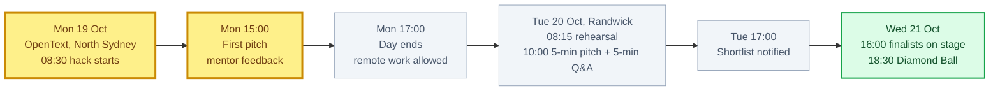
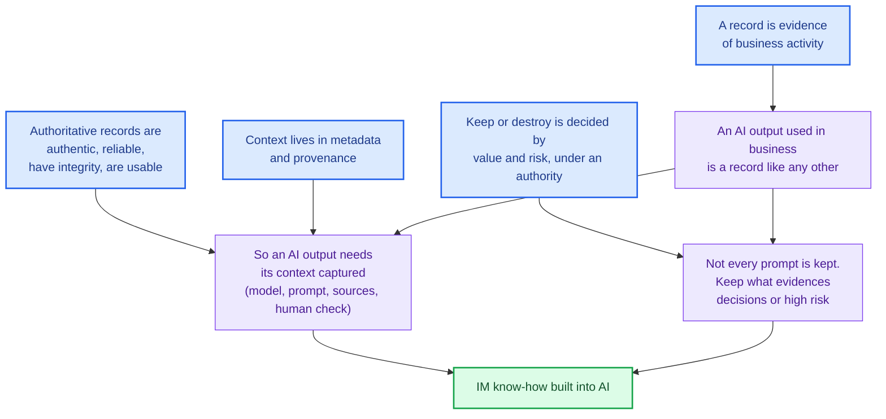

# 🧭 RIMPA Global Hackathon 2026, the full background

`Records & IM` `AI` `≈ 90 min read`

> [!NOTE]
> **What this note is**
> The ground you need before choosing an idea. It covers the brief as it actually reads, who
> judges it, what won the last two years, the records-management foundations the judges take
> for granted, how AI actually produces bias, misinformation and disinformation, verified case
> studies, what already exists, what is technically buildable in a day, and a fact-check of the
> team's brainstorm diagram.
>
> It does **not** pick an idea. The idea scorecard and the playbook come next and build on
> this note.

> [!NOTE]
> **How to read the sourcing**
> Every claim here came from six parallel research passes made on 15 Oct 2026.
> - Linked claims come from pages that were actually opened and read.
> - ⚠️ *unverified* marks a claim seen only in search-result
>   summaries, because the primary page (often naa.gov.au) timed out or blocked access. Do not put
>   these on a slide until you've opened the page yourself.
> - 💭 *inference* marks my reasoning, not a sourced fact.

> [!IMPORTANT]
> **Update, 16 Oct:** the deep-research run fetched the NAA AI-records page directly and confirmed the
> NAA claims marked ⚠️ below (AI output is a record, capture is risk-tiered, AI tools aren't recordkeeping
> systems). It also found NAA's new **agentic AI** section. See
> [`research/deep-research-2026-10-16.md`](../research/deep-research-2026-10-16.md), which supersedes
> this note where they differ.

---

## 1. The brief, as it actually reads

### The challenge text

From the Participant Hack Pack (section 01):

> Bias, misinformation, and disinformation pose serious challenges for information management
> professionals by reducing information quality and authenticity, undermining public trust, and
> weakening organisational integrity. These risks are increasingly amplified by AI technologies…

The five questions you are asked to address:

1. How is the use of AI **in organisations** leading to these problems?
2. What are the **long-term risks for records and archives** collections that need to be mitigated?
3. What **information management skills and practices** could guard against bias, misinformation and disinformation?
4. How can skills, practices, associated **standards and protocols** be implemented to provide a solution?
5. How can the solution help **information managers play a strategic role** in supporting AI initiatives and use?

The accepted output forms: a best-practice guide; a methodology, strategy or protocol; a
specification, algorithm or formula. The [event page](https://www.rimpa.com.au/events/ems-events-calendar/hackathon-2026.html)
also lists a "digital tool specification".

> [!WARNING]
> **Trap — Three things the brief says that are easy to miss**
> 1. **The subject is organisations and information managers, not the general public.** Your
>    brainstorm framed it as "the user". The brief puts the information manager at the centre:
>    question 5 asks how they gain a *strategic role*. An idea with no information manager in it
>    answers four questions out of five.
> 2. **Question 2 is about time.** It asks about records and archives *long term*: what happens
>    in 20 or 50 years to a record an AI touched. Almost nobody pitches for this, so it is open
>    ground.
> 3. **Software is not required.** A protocol, specification or formula is a valid output.
>    Working software still scores on *Functionality*, but it has to carry an IM idea, not stand
>    in for one.

### Schedule and format

- **Build time is about 8.5 hours on Monday, plus Monday evening.** The 3 pm mentor pitch is a
  dress rehearsal with expert feedback. Arrive with something to show by then.
- **The pitch is 5 minutes**, then 5 minutes of judges' questions. There's a lectern, a
  microphone and HDMI, so bring your own adaptor.
- **Prize:** $10,000 AUD, plus newsletter exposure, mentoring, and consideration by
  "influential stakeholders" for real implementation. The NAA is the exclusive sponsor.
- **Teams of 2 to 5.** At least one member must be in person, and the pitch must be delivered in person.
  ([event page](https://www.rimpa.com.au/events/ems-events-calendar/hackathon-2026.html))

### Judging criteria

> [!NOTE]
> **Version difference — Two versions exist. Use the hack pack's**
> The [event page](https://www.rimpa.com.au/events/ems-events-calendar/hackathon-2026.html) says
> *creativity, functionality, practicality, innovation*. The hack pack (p. 27), which is the
> document the judges are briefed with, says:
>
> | Criterion | The question asked |
> |---|---|
> | **Idea & Solution** | How creative is the idea behind the solution? |
> | **Fit** | How relevant is the solution to solving a commercial or social problem? |
> | **Functionality** | Could the solution work? Could it scale as a real-world solution? |
> | **Presentation & Team** | How persuasive was the pitch? How well balanced and credible is the team? |
>
> Both versions share creativity and functionality, and "practicality" from the event page maps
> onto *Fit*.

---

## 2. Who is judging, and who is mentoring

### The judges

| Judge | Role (hack pack) | What the public record shows |
|---|---|---|
| **Josephine Secis** | Assistant Director-General, Government Information & Collection Management, **NAA** | Joined NAA Jan 2024. Previously ran recordkeeping, collections and digital preservation at Queensland State Archives and led Queensland's first Digital Archive (launched 2023) ⚠️ *unverified*. No public talk on AI found. |
| **James Price** | Managing Director, Experience Matters | Founded an information-management consultancy. Co-author of *Information Asset Management*. Teaches data governance and quality at UniSA and chairs Data Leaders. His firm's line is that information is a business asset and **"software is not a silver bullet"** ([bio](https://dataleaders.org/james-price/), [firm](https://www.experiencematters.com.au/about-us/aboutus/)). |
| **Greg Long** | Assistant Director, Maritime Warfare Centre, RAN, Defence | **Nothing public found.** The Maritime Warfare Centre's remit includes information warfare ⚠️ *unverified*. |
| **Conni Christensen** | Founding Partner, The Synercon Group | 20+ years in records and IM, and a trainer and speaker for RIMPA and IIM ⚠️ *unverified*. In a 2014 talk she argued records work stays manual because **metadata standards and methods are inconsistent**, and proposed metadata modelling and capture driven by business-activity analysis ([slides](https://www.slideshare.net/InfoGovCon/conni-christensen)). |

> [!NOTE]
> **Our read — What each judge is likely to push on 💭 *inference***
> None of the four has a public statement on AI. This is reasoning from their roles, not a record.
> - **Secis (NAA, the sponsor):** fit with NAA policy and the Information Management Standard.
>   Authenticity over decades. Whether an agency could actually adopt it.
> - **Price:** where the business value is, and what happens beyond the software (governance,
>   behaviour, the people). A pure-tool pitch runs into his "not a silver bullet" view.
> - **Christensen:** metadata and classification rigour. Is the automation grounded in a
>   standard, or hand-waved?
> - **Long:** provenance, deliberate (adversarial) disinformation, and the quality of decisions
>   made on information.

### The mentors

You'll meet them on Monday, so use them as a free expert review.

| Mentor | Role | Worth asking about |
|---|---|---|
| Andrea McIntosh | GM Global Operations, Leadership Through Data | Microsoft 365 and Purview records governance. RIMPA partnered with her firm on Purview training ⚠️ *unverified*. Ask whether it would work in an M365 shop. |
| **Michelle Tolliday** | **Chair, ISO/TC 46/SC 11**, the committee that owns ISO 15489 ([ISO contact page](https://committee.iso.org/sites/tc46sc11/home/contact.html)) | Standards. Get your ISO references exactly right in front of her. Ask about the ISO AI-records work in progress (see §4). |
| **John Cox** | Business Development Manager, DatacomIT | **He was on the 2024 winning team** ([2024 write-up](https://www.rimpa.com.au/resource/what-was-it-like-participating-in-a-hackathon.html)). Ask what made it land. |
| Michael Haley | Secretary, Global Information Consortium | The GIC is a cross-sector IM community launched with ARMA International in 2023 ([launch](https://www.rimpa.com.au/resource/official-launch-of-the-gic.html)). |
| Errol Leboydre | Managing Director, WyldLynx | Government records, compliance and privacy firm. On a podcast he argued AI governance runs on first principles: auditability and guardrails ⚠️ *unverified*. |
| Mark Cornish | Technology Specialist | Nothing public found. |

> [!CAUTION]
> **Edge case — The PDF's text layer has stale names in it**
> If you copy text out of the hack pack you will see "Carolyn Tolliday", "Michelle Hartman" and
> "Peta Sweeney". Those are older names still in the PDF's hidden text layer. The rendered page
> shows **Michelle Tolliday**, and Hartman and Sweeney aren't shown at all. Use the names on the
> rendered page.

### RIMPA itself

The **Records and Information Management Practitioners Alliance – Global**, formerly *Records
and Information Management Professionals Australasia*, founded 1969. It renamed itself when it
moved to a corporate model. The CEO is Anne Cornish
([media release](https://www.rimpa.com.au/resource/media-release-rimpa-global.html)). The
audience is records professionals, not technologists.

---

## 3. What won before

| Year | Challenge | Winner | What they built |
|---|---|---|---|
| **2024** (Adelaide, 8 teams) | "How might information managers value information so that it is recognised as a strategic asset?" | *Hacks of Random Kindness*, a mix of industry veterans and a student, **including John Cox** | **A dashboard forecasting information value at 1, 6 and 12 months.** It had a **Cost** side (made visible with finance staff) and a **Value** matrix (protection, human dignity, carbon reduction). The core line was **"cost is factual, value is subjective."** It was built on existing IM resources such as information asset registers. ([write-up](https://www.rimpa.com.au/resource/what-was-it-like-participating-in-a-hackathon.html), [2024 page](https://www.rimpa.com.au/events/ems-events-calendar/hackathon-2024.html)) |
| **2025** (Melbourne) | Reduce the carbon footprint of information management practices, with ESG reporting | **NT Hackers**, led by a CDU AI master's student | **A cost-optimisation tool** that offsets CO₂, finds government grant opportunities, and **helps records managers decide what to archive and what to destroy**. Judges were "impressed by the tool's balance of sustainability and practicality". ([winner article](https://www.rimpa.com.au/resource/nt-team-win-hackathon.html), [2025 page](https://www.rimpa.com.au/events/ems-events-calendar/hackathon-2025.html)) |

> [!TIP]
> **Pattern — What both winners have in common 💭 *inference***
> 1. **They turned an abstract IM idea into something an executive cares about**: dollars,
>    grants, investment decisions.
> 2. **They put a core IM act inside the tool.** The 2025 tool decides what to keep and what to
>    destroy (appraisal and disposal). The 2024 one is built on the information asset register.
> 3. **Both were judged practical, not just novel.**
> 4. **Both teams were mixed**, with industry credibility alongside technical skill.
>
> With only two data points and thin published judge comments, read this as a pattern, not a rule.

---

## 4. Foundations of records and information management

Your diagram already reasons well about provenance and blockchain. What's missing is the
vocabulary the judges think in. Learn these six ideas; everything later in this note rests on them.

### 4.1 What a record is

> [!IMPORTANT]
> **Foundation — A record is defined by what it does, not what format it is in**
> **ISO 15489-1:2016** defines a record as *"information created, received and maintained as
> evidence and as an asset by an organization or person, in pursuit of legal obligations or in
> the transaction of business."* (quoted via the [UN Archives glossary](https://archives.un.org/node/494);
> the ISO text itself was not opened).
>
> The **Archives Act 1983 (Cth), s3** defines it in law as *"a document, or an object, in any form
> (including any electronic form) that is, or has been, kept by reason of: (a) any information or
> matter that it contains or that can be obtained from it; or (b) its connection with any event,
> person, circumstance or thing."*
> ([Act, compilation 48](https://www.legislation.gov.au/C2004A02796/2024-05-22/2024-05-22/text/original/pdf))

> [!NOTE]
> **Connection — Why this matters for AI**
> Neither definition mentions who or what wrote the record. A ChatGPT summary pasted into a case
> file is a record for exactly the same reason a human's note would be: it was kept as evidence
> of business. So the question is never *whether* AI output is a record. It is **which** AI
> outputs are kept, and **with what context**.

### 4.2 What makes a record trustworthy

> [!IMPORTANT]
> **Foundation — The four characteristics of authoritative records (ISO 15489-1, clause 5.2)**
> | Characteristic | Plain meaning |
> |---|---|
> | **Authenticity** | It is what it claims to be, made by who it claims, at the time it claims. |
> | **Reliability** | Its content can be trusted as an accurate account. It was made at or near the time, by someone with direct knowledge or by a routine system. |
> | **Integrity** | It is complete and unaltered, and protected against unauthorised change. |
> | **Usability** | It can be located, retrieved, presented and interpreted. |
>
> The four names are confirmed. The wording above follows the **2001** edition as quoted in
> [Kastenhofer (2015)](https://publications.archivists.org.au/index.php/asa/article/download/10605/10933).
> The 2016 wording was not opened. Michelle Tolliday chairs the committee that owns this
> standard, so **don't quote it verbatim on stage unless you've checked the 2016 text.**

> [!NOTE]
> **Connection — How each characteristic maps onto AI failure**
> This mapping is the bridge between the IM world and the AI world. It is the most useful frame
> in this note.
>
> | Characteristic | How AI breaks it |
> |---|---|
> | **Authenticity** | Deepfakes and synthetic documents claim to be something they aren't. |
> | **Reliability** | Hallucinated facts and citations. An LLM is not "someone with direct knowledge". |
> | **Integrity** | AI summaries that drop or invert meaning, and silent AI "enhancement" of images. |
> | **Usability** | In 50 years: which model made this, and can anyone still interpret it? Your "model retired" note. |

### 4.3 Context, provenance and metadata

- **Provenance**, in the archival sense, means keeping records of one creator together and
  in their original order. Unbroken custody is what makes forgery hard to hide
  ([SAA dictionary](https://dictionary.archivists.org/entry/provenance.html);
  [Kastenhofer](https://publications.archivists.org.au/index.php/asa/article/download/10605/10933)).
  This is a richer idea than the "content provenance" of C2PA.
- **ISO 23081** is the records-metadata standard. It sets principles for metadata about the
  record, the business rules, the agents, the activities and the processes. It does not mandate a
  fixed set of fields ⚠️ *unverified*.
- **The records continuum** (Frank Upward, Monash, 1996) sees create, capture, organise and
  pluralise as dimensions happening at once, not as stages in a life cycle. It was developed in Australia,
  so expect the judges to know it ⚠️ *unverified*.
- **OAIS (ISO 14721, edition 3, 2025)** is the digital-preservation reference model. Each package
  carries *Reference, Provenance, Context* and **Fixity** information. Fixity is the mechanism
  that detects undocumented change, usually a checksum ⚠️ *unverified*.

> [!NOTE]
> **Connection — For a data engineer**
> An AI-interaction record is a data contract plus lineage. Content plus a hash is *fixity*.
> Model, version, prompt and sources are *provenance and context*. Who checked it and when is the
> *agent and activity* metadata. You already think this way; ISO 23081 is the vocabulary for it.

### 4.4 Keep or destroy, and the law around it

> [!IMPORTANT]
> **Foundation — Destroying a Commonwealth record is an offence unless something authorises it**
> **Archives Act s24(1):** a person must not engage in conduct that results in the destruction or
> disposal, transfer, or **damage to or alteration** of a Commonwealth record.
>
> **s24(2)** lists the exceptions:
> - destruction required by any law;
> - with NAA permission or under a practice the NAA approves (records authorities);
> - **normal administrative practice (NAP)**;
> - placing the record in the custody of whoever is entitled to it.
>
> ([Act](https://www.legislation.gov.au/C2004A02796/2024-05-22/2024-05-22/text/original/pdf))

> [!CAUTION]
> **Edge case — s24(5), the clause a data engineer should know**
> For electronic records, *"any treatment or modification of the record that would prevent the
> obtaining from the record of information or matter that could previously have been obtained
> from the record shall be deemed to be destruction."*
>
> Read with AI in mind: a lossy AI transform, an overwritten field or a "cleaned" summary that
> replaces the original can legally count as **destruction**.
> ([Act](https://www.legislation.gov.au/C2004A02796/2024-05-22/2024-05-22/text/original/pdf))

- **Records authorities** (agency-specific, plus General Records Authorities) are the formal
  permission to dispose. **NAP** covers low-value, short-term material: drafts, transitory items,
  reference copies ⚠️ *unverified*.
- **High-value / high-risk records.** NSW defines *high value* as records needed to carry out
  functions and respond to audits, inquiries and legal issues. *High risk* means records whose
  misuse, release, alteration, loss or early destruction poses significant risk. Examples include
  case-management records, patient records and minister briefings
  ([NSW](https://www.nsw.gov.au/nsw-government/recordkeeping/plan/high-risk-records)).
- **Privacy pulls the other way.** APP 11.2 says destroy personal information you no longer
  need, *unless it is part of a Commonwealth record*. Delete-versus-keep is a built-in tension
  ⚠️ *unverified*.

> [!WARNING]
> **Trap — The retention figures in your diagram**
> - **"99-year retention, Child Sexual Abuse Royal Commission": wrong.** The Royal Commission
>   recommended keeping records about child sexual abuse **for at least 45 years** (Rec 8.1), with
>   archives authorities to require the same (Rec 8.2)
>   ([NSW Government](https://www.nsw.gov.au/nsw-government/recordkeeping/guidance-and-resources/royal-commission-responses)).
> - **"APRA rules, 7-year retention": not confirmed.** The 7 years is the requirement for
>   **company financial records** ([ASIC](https://asic.gov.au/for-business-and-companies/companies/company-building-blocks/company-record-keeping/)).
>   No APRA rule saying so was found.

### 4.5 What the regulators already say about AI records

| Jurisdiction | Position | Status |
|---|---|---|
| **NAA (Cth)** | AI-generated content created or received by agencies is a Commonwealth record. The Act is technology-neutral. **Agencies do not need to keep every prompt or chat.** Keep outputs that are final records, contribute substantially to significant records, evidence high-risk activity, or are relied on for decisions. Where AI informs decisions inside systems, also keep inputs, source data, instructions and audit logs. Capture records with metadata in a records system, **not only in the AI tool.** | ⚠️ *unverified*: naa.gov.au timed out for every researcher. Agrees with the [RIMPA summary](https://www.rimpa.com.au/resource/managing-records-created-with-ai-technologies-in-government.html). |
| **NSW** | Any record created during government business, by AI or a person, is a State record. AI "can lead to errors or bias". **Metadata must record that AI produced it, the software used, and the prompts, inputs or algorithms.** Records go into official recordkeeping systems. | [Fetched](https://www.nsw.gov.au/nsw-government/recordkeeping/create-and-capture/ai-and-recordkeeping): the most concrete metadata rule found. |
| **Victoria (PROV)** | AI Technologies and Recordkeeping policy v1.0, Feb 2024 to 2029. | ⚠️ *unverified* |
| **New Zealand** | Archives NZ 23/G25 (Dec 2023): AI outputs are public records. | ⚠️ *unverified* |
| **UK & Ireland (ARA)** | AI Preparedness Guidelines for Archivists (Feb 2026): document corpus completeness and **known biases**; strengthen metadata and provenance; give AI derivative copies and protect originals; treat AI outputs as **non-authoritative suggestions** with humans in the loop; ground generative tools with RAG and transparent source links. | [Fetched](https://www.archives.org.uk/ai-preparedness-guidelines-for-archivists): the most directly usable design source. |
| **UK (TNA)** | Five vendors trialled AI for records selection. None consistently beat the others, and "AI cannot replace the expertise of Records Managers". | [Fetched](https://www.nationalarchives.gov.uk/information-management/manage-information/preserving-digital-records/research-collaboration/using-ai-for-digital-selection-in-government/) |
| **DTA (Cth)** | Responsible-AI policy v2.0 (in force 15 Dec 2025): transparency statements, accountable officials, an internal **AI use-case register**, impact assessments, and reporting of high-risk uses. | ⚠️ *unverified*: details from a secondary summary. |
| **ISO/TC 46/SC 11** | Working Group 22 on AI and records was set up in 2024 and got going in May 2025 ([IDM](https://idm.net.au/node/15360)). An AI-records document "is in development" ([SC 11](https://committee.iso.org/home/tc46sc11)). **Nothing is published yet.** | Fetched |

> [!TIP]
> **Why it matters — The gap that falls out of this table 💭 *inference***
> The guidance agrees on *what* to capture: the AI flag, the tool and version, the prompts and
> inputs, and which outputs evidence decisions. It is silent on **how that gets captured at the
> moment of use**, when staff are pasting into a chatbot. The NAA says capture into a records
> system "not only in the AI tool"; NSW says record the software and prompts. No standard
> mechanism does that yet, and the ISO work is unpublished. **That is the space between policy
> and practice where a hackathon idea can live.**

### 4.6 NAA's own strategic framing

- **Building trust in the public record** (the NAA's IM policy) now runs to 31 Dec 2028. AI
  appears only in the foreword, which names AI and misinformation as reasons strong IM matters. No
  AI-specific requirements were added
  ([RIMPA](https://www.rimpa.com.au/resource/building-trust-in-the-public-record-extended-to-2028.html)).
- The NAA's **Strategy 2025–2030** cites "the rise of disinformation making trust in the national
  record more important than ever". One of its pillars, *Enable*, is about NAA leadership in agency
  IM ⚠️ *unverified*.
- The NAA's 2025 Check-up survey of 175 agencies reportedly found **87% use AI, 15% apply it to
  IM, 8% use it to create metadata** ⚠️ *unverified*. If it
  checks out, that is a strong "fit" statistic.

---

## 5. How AI produces bias, misinformation and disinformation

### 5.1 The vocabulary

> [!IMPORTANT]
> **Foundation — Information disorder (Wardle & Derakhshan, Council of Europe, 2017)**
> | Type | False? | Intent to harm? | Example |
> |---|---|---|---|
> | **Misinformation** | yes | no | An AI summary that wrongly drops a "not", forwarded in good faith |
> | **Disinformation** | yes | **yes** | A deepfake CFO on a video call |
> | **Malinformation** | **no**, genuine | yes | A real private record leaked to cause harm |
>
> The framework also names **three phases** (creation, production, distribution) and **three
> elements** (agent, message, interpreter). An interpreter can re-share with a *different* intent,
> so misinformation can turn into disinformation
> ([Shorenstein Center summary](https://shorensteincenter.org/information-disorder-framework-for-research-and-policymaking/)).

> [!WARNING]
> **Trap — Your diagram has two of the three**
> It has misinformation and disinformation but not **malinformation**. That gap matters for
> records people: for archives, the dangerous case is often *true* material released in the
> wrong context. That is the privacy and access side of their job.

First Draft's **seven types**, from satire up to fabricated content, are a useful gradient. The
order and wording weren't readable from the primary graphic, so check them before using them
([First Draft](https://firstdraftnews.org/articles/fake-news-complicated/)).

### 5.2 Bias, the three-layer and seven-source views

- **NIST SP 1270** (*Towards a Standard for Identifying and Managing Bias in AI*, March 2022,
  [NIST](https://www.nist.gov/publications/towards-standard-identifying-and-managing-bias-artificial-intelligence))
  splits AI bias into **systemic** (institutions disadvantaging groups), **statistical /
  computational** (unrepresentative samples, systematic error) and **human** bias. The categories
  are from a summary, because the PDF wasn't readable ⚠️ *unverified wording*.
- **Suresh & Guttag (2021)** give seven *sources* of harm across the ML life cycle
  ([arXiv](https://arxiv.org/abs/1901.10002)):

| Source | Meaning | Archives example (mine) |
|---|---|---|
| **Historical** | The world as it was, even with perfect sampling | Collections that recorded the powerful and not minorities |
| **Representation** | The sample under-represents part of the population | Digitised material skews to what got funded |
| **Measurement** | Features or labels are poor proxies | Legacy catalogue subject headings used as labels |
| **Aggregation** | One model for groups that differ | One summariser for every record type |
| **Learning** | Modelling choices widen gaps | |
| **Evaluation** | The benchmark doesn't represent the people served | |
| **Deployment** | Used differently than intended | A drafting aid used as a decision-maker |

> [!NOTE]
> **Connection — Your diagram's bias branch, located**
> "Models trained on skewed data / old catalogue language" and "historical archives didn't
> represent minority voices" are **historical**, **representation** and **measurement** bias in
> this table.
>
> **Be careful with one link.** No source was found showing that legacy *catalogue language*
> actually feeds AI bias. It is a plausible hypothesis, so pitch it as one. What *is* documented
> is the reparative-description work itself. The Library of Congress changed its "Illegal aliens"
> subject heading in 2021, after a 2016 attempt was blocked
> ⚠️ *unverified*.
>
> Your note "correcting bad history is also questionable" matches the archival answer: **keep
> the original language and add context notes**. That's what Yale and NCSU are reported to do
> ⚠️ *unverified*, and it is the same "protect the original, label
> the derivative" principle in the ARA guidelines.

- **Automation bias** is people over-trusting an automated aid. It produces **commission
  errors** (following the aid against other evidence) and **omission errors** (missing what the
  aid didn't flag). Training does not reliably prevent it (Parasuraman & Manzey 2010;
  Skitka et al. 1999) ⚠️ *unverified*. This is the human
  mechanism behind every case in §6: someone trusted the output.

### 5.3 Why LLMs make things up

> [!IMPORTANT]
> **Foundation — An LLM produces plausible text, not looked-up facts**
> **Kalai et al., *Why Language Models Hallucinate*** (OpenAI / Georgia Tech, Sep 2025,
> [arXiv](https://arxiv.org/abs/2509.04664)):
> - Hallucinations arise from ordinary statistical pressure in training. If a model can't tell a
>   true statement from a false one, it produces a plausible falsehood.
> - Hallucinations persist because benchmarks **reward guessing over saying "I don't know"**.
>   Models are optimised as test-takers.
>
> Arbitrary specifics, such as a particular citation, catalogue number or quote, can't be
> inferred from patterns. So they are exactly what gets made up.

The evidence, in rising order of relevance to records:

| Failure | Evidence |
|---|---|
| **Fabricated citations** | GPT-3.5 fabricated **55%** of its citations and GPT-4 **18%**. Of the real ones, 43% and 24% had substantive errors ([Walters & Wilder 2023](https://pmc.ncbi.nlm.nih.gov/articles/PMC10484980/)). These are 2023 models; current rates weren't checked. |
| **Retrieval (RAG) doesn't fix it** | Purpose-built legal AI tools still gave incorrect information in **more than 1 in 6** queries (Lexis+ AI and Ask Practical Law AI over 17%, Westlaw over 34%). Failure modes include retrieving inapplicable sources and **citations that don't support the claim** ([Stanford HAI](https://hai.stanford.edu/news/ai-trial-legal-models-hallucinate-1-out-6-or-more-benchmarking-queries)). LexisNexis disputed this. |
| **Transcription invents text** | About 1% of Whisper transcriptions contained whole phrases not in the audio, and **38% of those were harmful**. It happened more with speakers with aphasia ([Koenecke et al.](https://arxiv.org/abs/2402.08021)). This is directly relevant to meeting records, hearings and oral histories. |
| **Summaries lose meaning** | In an Australian ASIC trial (2024), human summaries of parliamentary submissions scored **81%** and the AI's **47%** ⚠️ *unverified*. |
| **Archival references invented** | The **ICRC** issued a public notice (Dec 2025): ChatGPT, Gemini and Copilot invent catalogue numbers and platforms that never existed, and a reference that can't be found *"does not mean that the ICRC is withholding information"* ([ICRC](https://www.icrc.org/en/article/important-notice-ai-generated-archival-references)). The **Library of Virginia** estimates about 15% of emailed reference questions are ChatGPT-generated, and "it is much harder to prove that a unique record doesn't exist" ([Scientific American](https://www.scientificamerican.com/article/ai-slop-is-spurring-record-requests-for-imaginary-journals/)). |

> [!WARNING]
> **Trap — Your "summaries that leave out or invert meaning"**
> It's real as an observed failure, but no source found names *omission / inversion* as a
> measured category. Say "AI summaries lose or distort meaning" and cite the ASIC trial.

### 5.4 The long-term risks (question 2 of the brief)

- **Model collapse.** Models trained recursively on AI-generated data lose the tails of the
  original distribution, and human-generated data becomes *more* valuable
  ([Shumailov et al.](https://arxiv.org/abs/2305.17493); Nature 2024). The finding concerns
  indiscriminate recursive training, so don't stretch it to "AI will degrade archives".
- **The liar's dividend.** Once people know media can be faked, *real* evidence can be dismissed
  as fake (Chesney & Citron, *California Law Review*, 2019)
  ⚠️ *unverified*. This is exactly your diagram's "question if
  real stuff is fake too".
- **Fakes of the historical record.** An AAP FactCheck (Sep 2025) debunked AI fakes of Australian
  history: a Gallipoli image, Phar Lap, and an altered State Library of NSW photo of the Harbour
  Bridge. A historian warned that when evidence is corrupted "falsehoods can flourish"
  ([AAP](https://www.aap.com.au/factcheck/ai-fakes-distort-australias-past/)).
- **Provenance loss over time** 💭 *inference*. Your diagram's
  sharpest question: *"they don't track model version, so what happens if a model is retired?"*
  A record made by a model that no longer exists, with no note of which model, can't be
  re-evaluated later. Its reliability can't be assessed, which is a *usability* failure 30 years
  out.

---

## 6. Case studies, verified

Each case is mapped to the records lesson. Use at most two in a pitch, and pick the ones closest
to your idea.

### Robodebt (Australia, 2015 to 2019)

- **What happened.** Pilots ran in 2015 and the online platform rolled out in **September 2016**.
  ATO annual income was *"divided up evenly"* across fortnights ("averaging") to raise debts, even
  though entitlement depends on actual fortnightly income. Averaging was abandoned in November 2019
  ([Royal Commission report](https://www.croakey.org/wp-content/uploads/2023/07/report_of-the-royal-commission-into-the-robodebt-scheme.pdf)).
- **The report.** It was tabled 7 July 2023 with 57 items: **56 recommendations plus one closing
  observation**. The Government accepted all 56
  ([response](https://www.pmc.gov.au/sites/default/files/resource/download/gov-response-royal-commission-robodebt-scheme.pdf)).
- **The settlement** was approved 11 June 2021. Say which figure you mean: $112m was the
  compensation, and over $1.7bn the total benefits ([Lawyers Weekly](https://www.lawyersweekly.com.au/biglaw/31621-robodebt-class-action-settlement-approved)).
- **On automated decision-making:**
  - **Rec 17.1** calls for a legal framework for automation, with a path to review, plain-language
    disclosure, and *"business rules and algorithms should be made available, to enable
    independent expert scrutiny."*
  - **Rec 17.2** calls for a body to audit automated decisions for *"fairness, the avoiding of
    bias, and client usability"*.
- **On records:**
  - **Rec 23.8:** the APSC should develop *"standards for documenting important decisions"*.
  - The Commissioner: *"There simply were not records kept of who decided what, when… The
    Commission found itself piecing together emails."*

> [!TIP]
> **Line to say — Robodebt is a records failure as much as an algorithm failure**
> No one could reconstruct who decided what. Automated decisions need the rules, the versions,
> the decision authority and the exclusion logic on record, or accountability can't be rebuilt
> afterwards.
>
> **Caution:** Robodebt was rules-based automation, not AI. Use it for the *automated decisions
> need records* argument, not as an "AI" example.

### Deloitte and DEWR (Australia, 2025)

- **What happened.** An assurance review of DEWR's Targeted Compliance Framework IT system
  (contract about **A$440k**) contained non-existent references, a fictional case extract, and a
  made-up quote attributed to a misnamed judge. The University of Sydney's Dr Chris Rudge flagged
  them ([The Register](https://www.theregister.com/software/2025/10/06/deloitte-refunds-australian-government-over-ai-in-report/722000)).
- **The disclosure.** The corrected version disclosed a generative-AI tool chain (Azure OpenAI
  GPT-4o) **only after** the errors came out ⚠️ *unverified wording*.
- **The refund.** Deloitte repaid **the final instalment only**, about $97.6k
  ⚠️ *unverified amount*, not the whole fee
  ([ABC](https://www.abc.net.au/news/2025-10-09/deloitte-pays-back-government-after-using-ai-in-report-containin/105865408)).
- **Records lesson.** AI output went into an official report with no disclosure, no audit trail
  and no citation check. The irony: the review was about tracing an automated system's rules back
  to law.

### Fake cases in court

- **Mata v Avianca** (US, June 2023): sanctions for submitting *"non-existent judicial opinions
  with fake quotes and citations created by … ChatGPT"* ([order](https://storage.courtlistener.com/recap/gov.uscourts.nysd.575368/gov.uscourts.nysd.575368.54.0.pdf)).
- **Dayal** (Victoria): a solicitor tendered an AI-generated list of authorities with inaccurate
  citations in the Federal Circuit and Family Court. In Aug 2025 his practising certificate was
  restricted to two years' supervised practice, with no trust money and no principal role
  ([VLSB+C](https://lsbc.vic.gov.au/news-updates/news/statement-mr-dayal-matter)).
- **NSW Supreme Court Practice Note SC Gen 23** (from 3 Feb 2025):
  - No generative AI in affidavits or witness statements.
  - Where AI is used for submissions, the author must verify every citation, and that
    verification **"must not be solely carried out by using a Gen AI tool"**.
  - Experts using AI must keep records and **annex their prompts**.
  ([practice note](https://supremecourt.nsw.gov.au/documents/Practice-and-Procedure/Practice-Notes/general/current/PN_SC_Gen_23.pdf))

> [!NOTE]
> **Connection — The courts are already doing records management of AI**
> Disclosure statements, prompt logs annexed to evidence, human verification of every authority.
> That's the protocol other sectors don't have yet.

### AI medical scribe (Australia, 2026)

- **What happened.** A patient's post-operative letter to her GP recorded that she used
  psychedelic mushrooms, which she says she never has. The AI scribe at her urology appointment
  introduced it. She found it by chance and feared it would affect her workers' compensation
  claim. The urologist apologised and corrected the record
  ([ABC, 14 Aug 2026](https://www.abc.net.au/news/2026-08-14/ai-medical-scribe-error-leaves-patient-devastated/107031672)).
- **The regulators.** AHPRA says the practitioner *"remains responsible for the health records"*
  ([AHPRA](https://www.ahpra.gov.au/Resources/Artificial-Intelligence-in-healthcare/Case-studies.aspx)).
  RACGP notes scribes mishear drug names and mix up past and current symptoms
  ([RACGP](https://www.racgp.org.au/running-a-practice/technology/artificial-intelligence-ai/artificial-intelligence-ai-scribes)).
- **Records lesson.** An AI-generated statement became the **authoritative record** and flowed to
  third parties, and nothing in the record marked it as AI-generated.

### Arup deepfake (Hong Kong, 2024)

- **What happened.** A finance employee joined a video call in which every other participant,
  including the "CFO", was a deepfake. About **US$25m** (HK$200m) left in 15 transfers. Arup
  confirmed *"fake voices and images were used"*
  ([CNN via ABC17](https://abc17news.com/money/cnn-business-consumer/2024/05/16/british-engineering-giant-arup-revealed-as-25-million-deepfake-scam-victim/)).
- **Records lesson.** A video call is not a record of authorisation. Approvals need an
  independently authenticated trail. This is **disinformation** in Wardle's sense.

### Dutch childcare benefits (Netherlands, 2013 to 2021)

- **The regulator's findings.** The Dutch Data Protection Authority found three unlawful uses of
  applicants' nationality. Two of them were **discriminatory**: as an indicator in the automated
  risk-classification model, and in tackling organised fraud. **Dual nationality** data that should
  have been deleted was retained
  ([AP report](https://zoek.officielebekendmakingen.nl/blg-945542.pdf)).
- **The inquiry.** The parliamentary inquiry *Ongekend onrecht* ("unprecedented injustice", Dec
  2020) found information to parliament was late, incomplete or wrong, and **called for
  information management to be prioritised** ([Kamerstuk](https://zoek.officielebekendmakingen.nl/kst-35510-2.pdf),
  [NOS](https://nos.nl/artikel/2361021-ondervragingscommissie-kinderopvang-ouders-ongekend-onrecht-aangedaan.html)).
- **The fallout.** The cabinet resigned in January 2021
  ([Amnesty](https://www.amnesty.org/en/latest/news/2021/10/xenophobic-machines-dutch-child-benefit-scandal/)).

> [!WARNING]
> **Trap — Describe the Dutch case precisely**
> Say "algorithmic risk scoring using nationality", not "AI". The model isn't described as machine
> learning in the regulator's report. Amnesty calls it self-learning, but the regulator doesn't,
> and a judge from Defence or the NAA may know the difference. Also avoid quoting a number of
> affected families, because sources range from 10,000 to over 20,000.

---

## 7. What already exists, and where it stops

| Category | What it does | Where it stops |
|---|---|---|
| **C2PA / Content Credentials** | Signed provenance manifests attached to media. Manifests *"can be separated"* from the asset. "Durable" credentials add a watermark or fingerprint to recover them ([C2PA FAQ](https://c2pa.org/faq/)). The US NSA, ASD's ACSC, the UK NCSC and Canada's Cyber Centre published joint guidance in Jan 2025 urging adoption. | **Proves who made it, not that it's true.** Voluntary. Media only, not text. Can be stripped. |
| **SynthID Detector** (Google) | Public portal since Oct 2026 for image, video and audio watermarks from several vendors ([ppc.land](https://ppc.land/googles-synthid-detector-gains-public-access-and-covers-4-companies/)) | **No API**, and the terms ban programmatic use, so it can't go in a tool. A clean result doesn't prove human origin. |
| **Citation checkers** (e.g. GPTZero Hallucination Check) | Parses references and checks them against bibliographic databases. Classes: exists / minor issues / fake / unknown ([technical report](https://gptzero.me/news/how-does-gptzeros-hallucination-check-detector-work-a-technical-report/)) | Vendor-evaluated on small sets. Built for documents and academic papers, **not records capture**. |
| **LLM fact-checking pipelines** (e.g. DeepMind SAFE) | Extract claims, search, judge. Agreed with human raters on about **72%** of facts ⚠️ *unverified* | About 1 in 4 judgements disagree with humans. Treat output as "evidence found / not found", **not a verdict**. |
| **Site-rating services** (NewsGuard) | Human-reviewed ratings of news *sites* | Rates the site, not the claim, and nothing about records. |
| **Microsoft Purview** | Retention policies for Copilot and other AI-app **prompts and responses**, stored in a hidden mailbox folder and searchable by eDiscovery ([Microsoft Learn](https://learn.microsoft.com/purview/retention-policies-copilot)) | Retention only. The docs don't say it captures **model or version**. No verification and no bias signal. Microsoft-only. |
| **Blockchain for archives** (ARCHANGEL, UK, 2017 to 2019) | University of Surrey with The National Archives and the ODI. Fingerprints of documents held on a permissioned blockchain, trialled with archives in Estonia, Norway, **Australia** and the US ([Surrey](https://blockchain.surrey.ac.uk/projects/archangel.html)). InterPARES and Lemieux's framework for blockchain as recordkeeping ([UBC](https://blockchain.ubc.ca/research/research-papers/blockchain-and-distributed-ledgers-trusted-recordkeeping-systems-archival)). | Your diagram's five objections stand. Above all, **integrity is not truth**, and records sometimes must be corrected or destroyed. |

> [!TIP]
> **Why it matters — The gap across all of it 💭 *inference***
> Verification tools check content. Retention tools keep content. **Nothing found does both and
> speaks the records language** (record or not, value, risk, which authority, what metadata).
> Verification and retention both exist, but no tool joins them with records judgement. One
> researcher's caution: "absence from limited searching, not proof."

---

## 8. What is buildable in a day

A practical brief, in case the idea involves software.

| Need | Option | Notes |
|---|---|---|
| Check a citation exists | **Crossref** REST API | Free. Polite pool: add `mailto=` to the query for 10 req/s on DOI lookups and 3 req/s on searches ([Crossref](https://www.crossref.org/blog/announcing-changes-to-rest-api-rate-limits/)) |
| | **OpenAlex** | Free key. The rules changed in 2026 and sources conflict, so get a key on Saturday ([help](https://help.openalex.org/how-to-use-the-api/rate-limits-and-authentication)) |
| | Semantic Scholar | Keyless shared pool; a key starts at 1 req/s ([API](https://www.semanticscholar.org/product/api)) |
| Existing fact-checks | Google Fact Check Tools API | Returns **existing** fact-checks only, so coverage will be thin for arbitrary claims ([docs](https://developers.google.com/fact-check/tools/api)) |
| **Google Scholar** | ❌ | No official API; scraping is against its terms ⚠️ *unverified ToS*. Your extension idea named it, so swap in Crossref and OpenAlex. |
| Browser UI | Chrome **side panel** (MV3) | `"sidePanel"` permission, Chrome 114+ ([docs](https://developer.chrome.com/docs/extensions/reference/api/sidePanel)). Make API calls from the service worker with `host_permissions`. |
| Read AI chat pages | DOM scraping | **Fragile.** Class names break, responses stream, and long chats are virtualised. A "save this response" button or "check selected text" is far safer than auto-capture. |
| Interaction log schema | OpenTelemetry GenAI conventions | `gen_ai.request.model` vs `gen_ai.response.model` (routing can change the model). Still in development and designed for servers ⚠️ *unverified* |

> [!CAUTION]
> **Edge case — The technical risk ranking**
> - **Low risk:** citation existence (structured APIs, a clear yes or no), and a local
>   hash-chained capture of what the user saves.
> - **Medium risk:** claim extraction plus search, where the output is evidence, not a verdict.
> - **High risk:** "fact-check anything visually written on any site", which is open-domain truth
>   detection that the field's best tools agree with humans on about 72% of the time.
>
> Build the low-risk core first, and demo the medium layer only if Monday goes well.

---

## 9. Your brainstorm diagram, audited

| Node | Verdict |
|---|---|
| Bias / Misinformation (accidental) / Disinformation (bad intent) | ✅ Correct. **Add malinformation** (§5.1). |
| Skewed training data, old catalogue language | ✅ Real categories. The catalogue → AI link is **a hypothesis** (§5.2). |
| Archives under-represent minorities; correcting history is questionable | ✅ The archival answer is to keep the original and add context. |
| Hallucinated facts and citations | ✅ Strong evidence (§5.3). |
| Summaries omit or invert meaning | ⚠️ Real, but cite the ASIC trial rather than a named taxonomy. |
| Transcription errors | ✅ Whisper study and the AI scribe case. |
| Deepfakes, synthetic documents, fake historical images | ✅ Arup, AAP FactCheck. |
| Robodebt | ✅ But it's **rules-based automation**, not AI. Use it for "automated decisions need records". |
| AI scribes writing falsehoods | ✅ ABC Aug 2026, AHPRA, RACGP. |
| Deloitte citation scandal | ✅ Partial refund (final instalment), not the full fee. |
| Fake court cases | ✅ Mata v Avianca, Dayal, NSW SC Gen 23. |
| Deepfake video scams | ✅ Arup, about US$25m. |
| Dutch algorithm flagged dual nationals | ⚠️ Nationality was a risk indicator; dual-nationality data was unlawfully retained. Say "algorithmic", not "AI". |
| Proving real vs fake is cat-and-mouse, so prove provenance instead | ✅ A strong framing, and consistent with C2PA's own design. |
| Content Credentials can be removed, adoption is voluntary | ✅ Per the C2PA FAQ. |
| Blockchain objections 1 to 5 | ✅ All hold. ARCHANGEL and InterPARES are confirmed. |
| NAA says AI outputs should be treated as records | ✅ With nuance: **risk-based**, not every prompt (§4.5). |
| They don't track model version; what if a model is retired? | ✅ The best insight on the board. No guidance found specifies it, and Purview's docs don't mention capturing it (§4.5, §7). |
| Agentic AI is unknown territory for them | 💭 *inference* Plausible. NAA guidance reportedly frames Copilot-style tools as agents. |
| WHO table (creators, practitioners, custodians, regulators, suppliers, end users) | ✅ A good stakeholder map. **Practitioners** are the brief's protagonist. |
| Finance: APRA, 7-year retention | ❌ The 7 years is Corporations Act financial records (ASIC). APRA not confirmed. |
| Child-related: 99-year retention | ❌ **45 years**, Royal Commission Rec 8.1. |
| Chrome extension: fact-check anything, using Google Scholar | See §8. No Scholar API, and open-domain fact-checking is the high-risk layer. |

---

## 10. What this background implies

These are the constraints the scorecard will be built from. They are not a choice yet.

> [!TIP]
> **Pattern — Six constraints any winning idea has to meet 💭 *inference***
> 1. **An information manager is the hero**, not only the end user. Question 5 and the winners'
>    pattern both point this way.
> 2. **It applies an IM act to AI output**: classify, capture metadata, appraise value and risk,
>    keep or dispose. Verification without IM is a generic AI tool.
> 3. **It speaks the four characteristics.** Authenticity, reliability, integrity and usability
>    give you a frame the judges already own.
> 4. **It cites real guidance**: the NAA's risk-based position, NSW's AI metadata rule, the ARA
>    guidelines, SC Gen 23 as a precedent. And it **fills the documented gap** between policy and
>    capture at the point of use.
> 5. **It answers the long-term question.** Model and version retirement, re-checkability in 30
>    years, the liar's dividend.
> 6. **It has a money or risk line for an executive.** Deloitte's refund, Robodebt's settlement,
>    the Arup loss.

> [!NOTE]
> **Our read — Open questions for you before the scorecard**
> - Which sector would you pitch to? Government is the sponsor's home, but health (scribes) and
>   legal (fake cases) have the sharpest stories.
> - What do the two consultants on your team know best? Their sector experience could decide the
>   "Fit" story.
> - Is pre-built code allowed? The hack pack doesn't say. Ask admin@rimpa.com.au or the organisers
>   at the 08:00 rules briefing.

---

## Sources still to check yourself

These timed out or were blocked for every researcher. Open them in a browser before quoting:

- NAA: *Information management for records created using AI technologies*, plus the Building trust
  policy, the Information Management Standard, and the 2025 Check-up results.
- The DTA Policy for responsible use of AI in government v2.0, and the AI impact assessment tool.
- The ASD/NSA joint *Content Credentials* information sheet (Jan 2025).
- ISO 15489-1:2016, clause 5.2 wording (via Standards Australia, AS ISO 15489.1:2017).
- The DEWR TCF final-report page (Deloitte refund amount and AI disclosure wording).
- The Federal Court GPN-AI practice note (16 Apr 2026).
