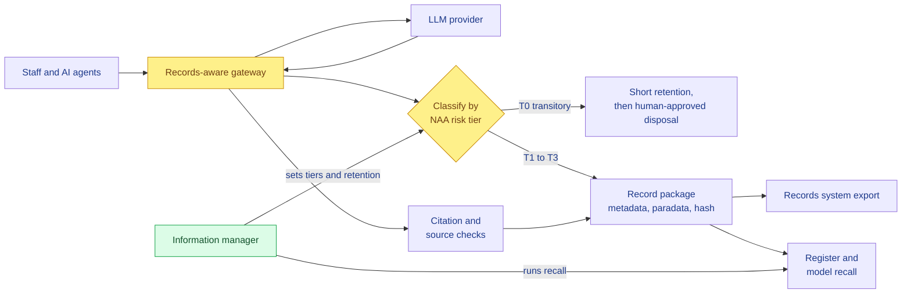

# Concept: the AI Record Passport

*Working name. It's a records-aware gateway that issues a "passport" for every AI output that matters.*

Status: **draft for the team's Sunday decision.** Facts are cited to
[`research/`](../research/deep-research-2026-10-16.md). Our own design choices are marked 💭.

---

## One sentence

> Every AI call and agent action in the organisation passes through one gateway. It applies the NAA's
> own risk tiers to decide what becomes a record, attaches the metadata regulators already require,
> checks the citations, and lets the information manager **recall** every record a faulty model touched.

## The problem in records terms

| What the regulators require | Why organisations can't meet it today |
|---|---|
| AI output is a record (NAA, NSW, PROV, QLD) | It sits inside ChatGPT or Copilot, and **AI tools aren't recordkeeping systems** (NAA, QLD) |
| Keep prompts and sources **when the output is retained or informs a decision**, with more evidence the more the decision relies on AI (NAA) | Nothing decides this per interaction. Logs are kept forever or not at all |
| Metadata must say AI made it, which software, and which prompts and inputs, and be perpetually linked (NSW) | Copy-paste strips all of it |
| The source of the data must be identifiable (QLD) | QLD admits Copilot may not expose it |
| Bias and hallucination risks must be documented per AI tool (PROV) | No register links that documentation to the records the tool produced |
| Agentic AI: capture system prompts, agent instructions, activity logs (NAA) | NAA has **no specific guidance yet** |
| 💭 Nobody records *which model version* made a record | When a model is retired or found faulty, no one can find what it affected |

## How it works

### 1. Capture: the gateway
- It is an OpenAI-compatible proxy, so apps and agents point at it instead of at the provider. 💭
- Every request and response is logged with the user, the application or agent, a timestamp, and the
  **model returned in the response** (not just the one requested, since providers can route).

### 2. Classify: the NAA rule, tiered
💭 Our tiers, derived from the NAA's risk-tiered rule:

| Tier | Meaning | What's kept | Retention default 💭 |
|---|---|---|---|
| **T0 Transitory** | Drafting, brainstorming, not relied on | The log entry only | Short and set (QChat's 3 months is the precedent), then **human-approved** disposal (PROV) |
| **T1 Retained output** | The output became part of a document or record | Record package: AI flag, model and version, prompt, inputs, **link to the final document** | Follows the business record's own disposal class |
| **T2 Decision-informing** | The output informed a decision about a person, case or money | T1 plus **source data**, **citation checks**, and **mandatory human sign-off** with a named reviewer (PROV) | Same as the decision record |
| **T3 Agentic action** | An agent *did* something: sent, updated, approved | T2 plus **system prompt, agent instructions, tool calls, activity log** (NAA's agentic list) | Same as the decision record |

**How the tier is set:** every app or agent is registered with a default tier. The information manager
sets these from the use register (PROV clause 1 fields). Events then escalate the tier: export to a
document makes it at least T1, a "decision" flag makes it T2, and a tool call with side effects makes it
T3. 💭 The rules are deterministic and explainable. **No LLM decides whether something is a record.**

### 3. Check: misinformation controls
- **Citations:** extract the references and look them up in Crossref and OpenAlex. Each one is
  reported as *found*, *not found* or *mismatch*, and **never as "true" or "false"**. A human decides.
- **Sources:** if the app uses retrieval, record the IDs of the source documents, which meets the QLD
  rule.
- **AI flag:** always set, and perpetually linked (NSW).

### 4. Package: the passport

💭 One JSON record package per T1–T3 event, grouped so it maps onto records metadata:

| Group | Fields | Comes from |
|---|---|---|
| **Record** | id, content, SHA-256 hash, previous-package hash, created, `ai_generated: true`, link to final document | NSW, QLD, ISO 15489 integrity |
| **Agent** | human user, AI system, model requested, **model returned**, provider | NSW "software used", InterPARES technical paradata |
| **Business** | use-case id, function or classification, tier, disposal class | NAA risk rule, PROV register |
| **Process** | prompt, system prompt, inputs, sources, citation results, tool calls | NSW prompts and inputs, NAA agentic list |
| **Review** | reviewer, decision, timestamp | PROV human oversight |
| **Paradata** | use-register id, impact assessment ref, policy version | InterPARES organisational paradata |

⚠️ The mapping onto ISO 23081's entities is still to be checked (open question 6).

**Integrity without blockchain:** each package carries the hash of the previous one, so the log is
tamper-evident. Corrections are allowed as new versions linked to the original. That keeps the
benefits from our blockchain thread without its problems: we can still correct and dispose. 💭

### 5. Recall: the novel piece 💭
1. The information manager marks a model and version as **withdrawn or faulty from a date**. For
   example, the vendor retires it, or it's found to fabricate citations or show bias.
2. The register returns every T1–T3 record that model produced, **sorted by tier**.
3. A re-review queue opens, and every action is logged.
4. You get a targeted re-check of a few hundred high-risk records instead of everything, or nothing.

This is the product-recall idea applied to AI-made records. It answers question 2 of the brief: what
happens long-term when the model behind a record is gone.

## How it answers the brief

| Brief question | Our answer |
|---|---|
| 1. How AI use in organisations causes these problems | Hallucinated citations (Deloitte), unmarked AI text becoming the record (the AI scribe), no record of who decided what (Robodebt) |
| 2. Long-term risks to records | Records whose model is gone and whose sources can't be traced can't be re-evaluated. **Recall** addresses it |
| 3. IM skills and practices | Appraisal (tiers), metadata, provenance and paradata, integrity (hash), disposal with oversight |
| 4. Implementing standards and protocols | Implements NAA's risk rule, the NSW metadata, the QLD source rule, PROV oversight, the NAA agentic list. 💭 The tier rules and the package can be **published as an open protocol** as well as code |
| 5. A strategic role for information managers | They set the tiers, own the register and run the recall. Records management sits in the AI control loop, not after it |

## Demo path (about 90 seconds of the 5 minutes)

💭 The scenario: a caseworker assessing a hardship application, a deliberate echo of Robodebt.

1. The caseworker asks the assistant to summarise the policy and cite authorities. One citation is
   fabricated, and the gateway shows it **red: not found**.
2. They use the summary in their decision, so the event is **T2**. The passport opens, showing the
   model version, prompt, sources, citation results, the reviewer sign-off prompt, and the hash.
3. "Six months later, the vendor retires this model after a fabrication bug." The information manager
   clicks **Recall**, and the screen shows **14 records, 3 decision-informing**, queued for re-review.

Steps 1 and 2 run live. Step 3 runs on **seeded data**, and we'll say so.

## Build plan for Monday (if the rules allow)

| Block | What | Done when |
|---|---|---|
| 09:00–10:30 | Gateway proxy (Python, FastAPI) plus SQLite log, forwarding to one LLM API | A call goes through, and the model returned is stored |
| 10:30–11:30 | Tier rules plus record package plus hash chain | A T2 package is generated from a call |
| 11:30–12:30 | Citation check against Crossref and OpenAlex | A fake reference comes back "not found" |
| 13:00–14:00 | Console: live feed, package view, recall screen (Streamlit) | The demo path clicks through |
| 14:00–14:30 | Seed recall data, record a backup video | **Feature freeze 14:30** |
| 15:00 | Mentor pitch | |

## Risks and answers

| Risk | Answer |
|---|---|
| "LLM gateways already log calls" (Langfuse, Helicone, Portkey…) | ⚠️ To verify (open question 2). Our claim is the **records layer**: tiers, disposal, record export, paradata, recall. Logging is the plumbing, not the product |
| "Isn't this Purview?" | ⚠️ To verify (open question 3). Purview retains Copilot prompts and responses. Its docs don't mention the model version, and it doesn't verify or recall. It's also Microsoft-only, while the gateway is vendor-neutral |
| Staff bypass the gateway with personal ChatGPT | It's a policy and network control. The same is true of any records system. The register makes any bypass visible |
| Privacy: capturing prompts with personal information | T0 has a short, set retention with human-approved disposal. APP 11 and the Archives Act tension is handled by the tier |
| Citation check false alarms | It reports "not found", never "false", and a human signs off |
| NAA publishes agentic guidance and closes the gap | Then we implement it. The tier table is configuration |
| Scope creep in 8 hours | One demo path. Recall runs on seeded data |
